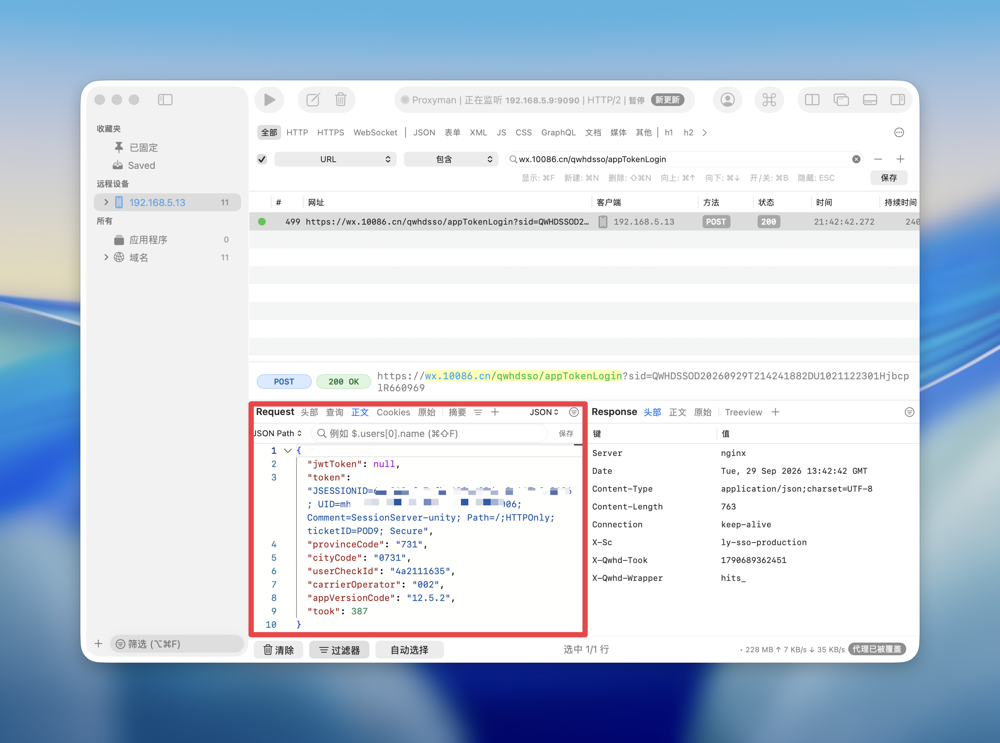

# 移动签到 · Docker 网页应用

基于 [yupaiLy/cmcc-auto-checkin](https://github.com/yupaiLy/cmcc-auto-checkin) 改写的自托管应用。
通过网页管理账号、安排每日签到、手动执行活动并查看日志，一条 Docker Compose 命令启动。

源码仓库：[Rain520/cmcc-daily](https://github.com/Rain520/cmcc-daily)，提交后 GitHub Actions 会自动运行测试、构建镜像并执行容器冒烟测试。

已发布镜像：[rain5201/cmcc-daily](https://hub.docker.com/r/rain5201/cmcc-daily)，标签 `1.1.1` / `latest`（含 Webhook 推送、网页修改管理密码与通知测试），支持 AMD64 与 ARM64。飞牛 NAS 可直接导入 `compose.fn.yaml`，设置 `CMCC_WEB_PASSWORD`（可留空，默认 `123456`）后启动，访问 `http://NAS的IP:18080`，无需上传源码或本地构建。已有部署升级只需 `docker compose pull && docker compose up -d`，账号、密码和执行记录都在数据卷中，不会丢失。

## 可以做什么

- **网页管理账号**：添加、编辑、删除多个账号；已保存的 Token、Cookie 和推送密钥不回传浏览器，编辑时留空保留。
- **每日计划**：每个账号分别设置时间，默认 `Asia/Shanghai`。可选择累计奖励、AI 豆、拓展活动和周三拼图。
- **手动执行**：签到、周三拼图、评价有礼、话费查询；支持仅查询状态和停止任务。
- **执行记录**：查看排队、运行、完成、失败和中断状态；日志自动刷新、隐藏凭证，默认保留 30 天。
- **持久化与恢复**：账号、JWT 缓存和记录保存在数据卷中。容器重建不丢失；任务串行执行，同一账号不会重复排队。
- **单容器部署**：Python 3.12 + Flask + Waitress + SQLite，无需额外数据库、Redis 或外部 cron。

网页默认只安排每日签到。评价有礼会提交上游设定的 **10 分评价**，仅由你在手动任务里选择后执行，不自动兑换。秒杀脚本保留为命令行功能。

## 快速部署

需要 Docker Engine / Docker Desktop 和 Docker Compose v2。进入本项目目录：

```bash
cp .env.example .env
```

Windows PowerShell：

```powershell
Copy-Item .env.example .env
```

编辑 `.env`，设置初始管理密码（可留空，首次启动默认 `123456`；至少 6 位）：

```dotenv
CMCC_WEB_PASSWORD='你自己设置的密码'
```

然后构建并启动：

```bash
docker compose up -d --build
docker compose ps
docker compose logs -f --tail=100 cmcc
```

打开 **[http://localhost:8080](http://localhost:8080)**，使用该密码登录（没有设置时是 `123456`）。
首次启动不需要账号凭证，登录后在页面点击「添加账号」。新账号默认不开启每日计划，保存后可以先手动选择「仅查询状态」。

上面的源码部署命令会在你的机器上构建 `cmcc-daily:local`。基础镜像和 Python 依赖需要可访问的 Docker / PyPI 网络。直接使用已发布镜像时，请改用 `compose.fn.yaml` 或 `compose.image.yaml`。

后续更新发布可参考 [镜像发布流程](docs/PUBLISHING.md)。工作流支持 GitHub Actions 构建 AMD64 / ARM64 镜像，也可使用本机 Docker Desktop。

### 部署到 NAS / Linux 服务器

默认端口只绑定本机，远程访问时在 `.env` 设置服务器的局域网 IP，或：

```dotenv
CMCC_BIND_ADDRESS=0.0.0.0
CMCC_WEB_PORT=8080
```

重新运行 `docker compose up -d`，浏览器访问 `http://服务器IP:8080`。
如果通过 HTTPS 反向代理访问，设置 `CMCC_SECURE_COOKIE=true`，代理到容器的 8000 端口或宿主机映射端口。应用部署在域名根路径，资源不依赖外部 CDN。

## 管理密码

管理密码保存在数据卷的 `auth.json` 中，使用加盐 PBKDF2 散列，明文不落盘；容器重建、镜像升级都不会覆盖它。

- 不设置 `CMCC_WEB_PASSWORD` 时，首次启动的默认密码是 **`123456`**；只要还在用默认密码，登录后的页面顶部会提示。
- 登录后点击右上角 **修改密码**，输入当前密码和新密码即可。新密码至少 6 位，修改后其他已登录的会话立即失效，当前页面保持登录。
- 环境变量和 `CMCC_WEB_PASSWORD_FILE` 只在首次启动（数据卷里还没有 `auth.json` 时）生效。想用环境变量重新覆盖，设置 `CMCC_PASSWORD_RESET=true` 重启一次，然后删除该变量。
- 忘记密码时：停止容器 → 删除数据卷中的 `auth.json`（保留其他文件）→ 重新启动，即恢复为环境变量中的密码或 `123456`。

## 获取账号凭证

1. 在手机配置 HTTPS 抓包工具，打开中国移动 App → 我的 → 签到领流量。
2. 找到 `wx.10086.cn/qwhdsso/appTokenLogin` 的 POST 请求。
3. 将请求体 `token` 的完整值填入网页的 **App Token**。
4. 填写手机号，并照抄该请求体的 `provinceCode`、`cityCode`。默认的 `731` / `0731` 是湖南示例，应按自己的请求修改。



JWT 会自动续期并写入数据卷；续期和 App Token 登录都失败时，重新抓包，在网页编辑账号并填写新 Token。有效期由中国移动服务端决定，不能保证永久有效。

话费查询还需要：手机进入 App 充值页，从 `touch.10086.cn` 的 Cookie 中复制 `jsessionid-cmcc` 的**值**，填入「通知与高级配置 → 话费会话 Cookie」。该会话过期需重新获取。

## Webhook 通知

在「账号 → 编辑 → 通知与高级配置」填写 **Webhook 推送地址**，可与 Server酱、Bark 同时启用。此功能与下面的密码管理、通知测试都已包含在 `1.1.1` 镜像中。

- 接收地址使用公网 HTTPS；可选的 **Webhook Bearer Token** 只填写令牌本身，发送时加入 `Authorization: Bearer <令牌>`。
- 使用 POST。企业微信群机器人（`qyapi.weixin.qq.com/cgi-bin/webhook/send`）、钉钉机器人（`oapi.dingtalk.com/robot/send`）和飞书机器人（`open.feishu.cn/open-apis/bot/v2/hook/...`）会自动改用各自的消息格式；其他地址按 `{"title":"通知标题","body":"结果正文"}` 推送，需要接收端支持该格式。
- 机器人接口在参数不合法时也会返回 HTTP 200：现在会检查正文里的 `errcode`/`code`，非 0 记作发送失败，并在日志和测试结果里显示错误码。
- 与现有通知在相同位置触发：脚本生成结果或错误通知时发送；停止、强制超时或容器中断不保证通知。仅查询任务也可能发送通知。
- HTTP 2xx 视为投递成功；超时为 15 秒，不跟随重定向、不自动重试。各渠道互不影响，投递失败写入执行日志，不改变签到结果。
- 已保存的地址和令牌不回传浏览器，编辑时留空保留；停用时勾选清除 Webhook 地址，若配置过 Token，请一并清除。
- 编辑账号时可以点 **发送测试通知**：按当前填写的内容（含尚未保存的修改）给 Server酱、Bark、Webhook 各发一条测试消息，并逐条显示 HTTP 状态或失败原因。测试不会保存配置、不会签到，也不会写入执行记录。

原脚本单独运行时，可在配置文件设置 `webhook_url`、`webhook_token`，或使用环境变量 `CMCC_WEBHOOK_URL`、`CMCC_WEBHOOK_TOKEN`；网页任务使用各账号自己的配置。

## 计划、执行结果和数据

- 每日执行时间使用 `TZ` 指定的时区。添加或修改计划后，从下一个执行时间开始。
- 应用停机错过计划后，启动时补排一次，不逐天追补。运行中的任务若因停机中断，标记为「已停止」，不会自动重试；已经排队的任务在重启后继续。
- 所有账号共用一个串行队列。上一任务未结束时，后续任务会等待；每个账号最多一个待执行或运行中的任务。如果定时触发时该账号已有任务，本次不再重复排队。
- 「执行完成」代表上游脚本正常退出。部分附加活动可能失败、未开放或没有库存，请查看日志中的每项结果。
- 「仅查询状态」不执行签到、领奖、评价或抽奖消耗；仍会建立登录会话、访问活动页和更新本地缓存。活动页访问本身可能触发服务端的进页奖励，配置的通知渠道也可能收到状态推送。
- 当前网页没有修改秒杀参数、定时评价或自动兑换的功能；这些仍可使用原脚本命令行。

Docker 命名卷 `cmcc-data` 挂载到 `/data`，实际卷名由 Compose 项目名前缀决定：

```text
/data/
  cmcc.sqlite3       # 账号、计划、执行记录
  session-key.json   # 登录会话签名材料
  auth.json          # 管理密码散列（加盐 PBKDF2，明文不落盘）
  cache/            # 按完整手机号的散列区分 JWT
  logs/             # 每次任务的日志
  runtime/          # 任务使用的短期配置副本，结束后删除
  app.lock          # 防止同一个卷同时启动多个实例
```

凭证在卷中以明文保存，文件由容器用户读写；请将数据卷及备份按密码文件保管。容器以 UID/GID `10001:10001` 运行，根文件系统只读。建议使用默认命名卷；改用宿主机目录时，需让该 UID/GID 对目录有读写权限。

更新代码后运行 `docker compose up -d --build` 即可重建。`docker compose down` 保留数据；**`docker compose down -v` 会删除数据卷**。
备份时先 `docker compose stop cmcc`，再 `docker compose cp cmcc:/data ./backup-data`，完成后 `docker compose start cmcc`。

## 配置项

| 环境变量 | 默认值 | 作用 |
| --- | --- | --- |
| `CMCC_WEB_PASSWORD` | `123456` | 首次启动的初始管理密码，至少 6 位；之后在网页修改，重启不会覆盖 |
| `CMCC_BIND_ADDRESS` | `127.0.0.1` | Compose 宿主机监听地址 |
| `CMCC_WEB_PORT` | `8080` | Compose 宿主机端口 |
| `TZ` | `Asia/Shanghai` | 每日计划和上游活动判断使用的时区 |
| `CMCC_TASK_TIMEOUT` | `3600` | 每次任务最大执行秒数，30～86400 |
| `CMCC_RETENTION_DAYS` | `30` | 历史记录和日志保留天数，1～365 |
| `CMCC_SECURE_COOKIE` | `false` | 使用 HTTPS 时设为 `true` |
| `CMCC_PASSWORD_RESET` | 未设置 | 设为 `true` 重启时用环境变量覆盖数据卷中的管理密码 |

直接 `docker run` 或自定义 Compose 时还支持 `CMCC_WEB_PASSWORD_FILE`（从 Docker secret 文件读取密码）、`CMCC_DATA_DIR`（默认容器 `/data`）、`CMCC_BIND` / `CMCC_PORT`（容器内默认 `0.0.0.0:8000`）。

网页账号配置优先使用数据库中的设置，**不继承宿主机的 `CMCC_APP_TOKEN` 等账号变量**，避免不同账号被同一个环境变量覆盖。原脚本单独运行时仍支持原有环境变量。

## 保留的命令行功能

原来的 6 个模块保留在镜像的 `/app`。例如，复制 `config/config.example.json` 为 `config/config.json` 并填入凭证后：

```bash
docker compose run --rm --no-deps -v ./config:/config:ro --entrypoint python cmcc \
  /app/cmcc_sign.py --config /config/config.json --dry-run
```

可以同样调用 `cmcc_wed.py`、`cmcc_rate.py`、`cmcc_fee.py`、`cmcc_seckill.py`。`cmcc_extra.py` 由签到脚本调用。不要同时从网页和独立命令行执行同一账号，独立命令行不经过网页任务队列。
原参数和抓包说明见 [上游原始说明](docs/UPSTREAM_README.md)，缓存目录、只查询行为等有差异时，以当前文档为准。

## 本地开发与验证

```bash
python -m venv .venv
# 激活虚拟环境后：
pip install -r requirements.txt
python -m unittest discover -s tests -v
```

设置可选的 `CMCC_WEB_PASSWORD`（不设置时首次启动使用默认密码 `123456`）和 `CMCC_DATA_DIR` 后执行 `python -m cmcc_app`。
`python -m cmcc_app check-config` 只校验启动配置，不联系中国移动；`python -m cmcc_app healthcheck` 检查本机网页服务及调度线程。

Docker 验证：

```bash
docker build -t cmcc-daily:test .
python tests/container_smoke.py
```

容器冒烟测试验证登录、账号增删、重启持久化、非 root、只读文件系统和健康检查，使用临时账号且关闭计划，不访问中国移动活动接口。GitHub Actions 已配置相同流程，推送到你自己的仓库后会执行；本地修改本身不会触发远程 CI。

## 来源与改动

读取并移植的上游版本：[`7ae5f666d2aa0618be6a6fd26e8410b4416dbb39`](https://github.com/yupaiLy/cmcc-auto-checkin/tree/7ae5f666d2aa0618be6a6fd26e8410b4416dbb39)。原作者为 yupaiLy，原有活动接口逻辑与注释保留。

本次新增网页、账号存储、后台调度、任务进程隔离和 Docker 部署；同时调整 JWT 持久化与同尾号隔离、话费配置优先级、去除日志中的会话令牌，并修复秒杀只查询时补签、评价查询失败却正常退出的问题。

上游快照未包含 LICENSE 文件，本项目没有替上游代码声明新的开源许可证。原免责声明保留在上游说明中。活动接口可能随运营方调整而失效，本项目与中国移动官方无关。
