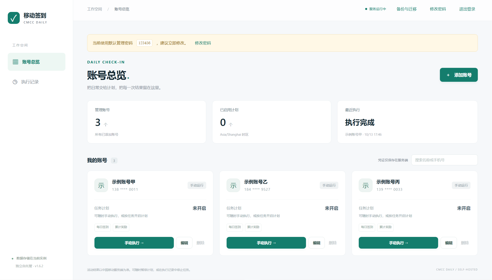
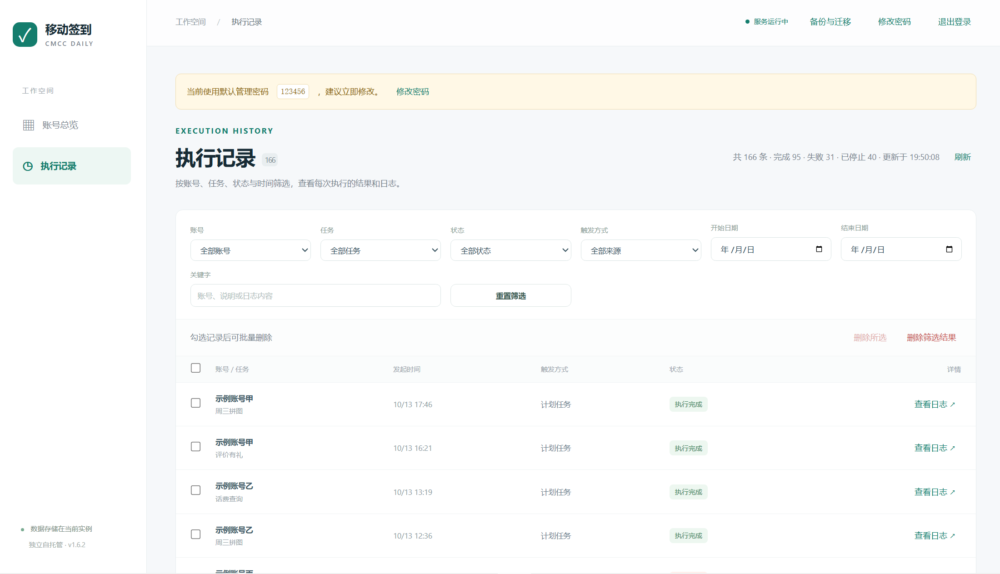
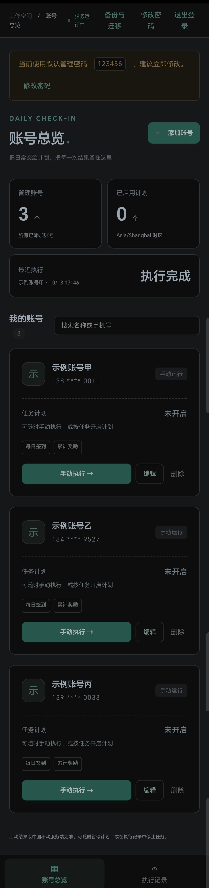
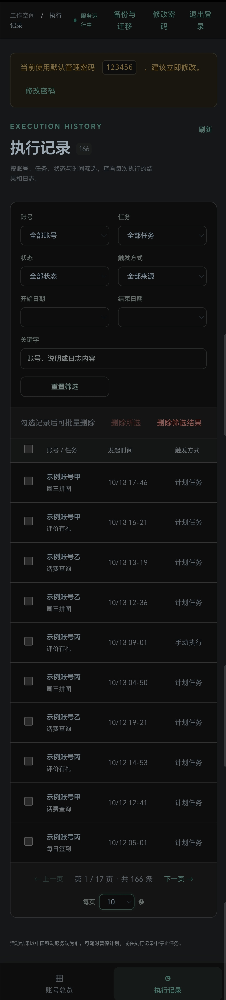

# 移动签到 · Docker 网页应用

基于 [yupaiLy/cmcc-auto-checkin](https://github.com/yupaiLy/cmcc-auto-checkin) 改写的自托管应用。
通过网页管理多个移动账号，为每个任务单独安排执行时间，随时查看结果与日志，一条 Docker Compose 命令启动。

源码仓库：[Rain520/cmcc-daily](https://github.com/Rain520/cmcc-daily)，提交后 GitHub Actions 会自动运行测试、构建镜像并执行容器冒烟测试。

已发布镜像：[rain5201/cmcc-daily](https://hub.docker.com/r/rain5201/cmcc-daily)，当前标签 `1.6.6` / `latest`，支持 AMD64 与 ARM64。飞牛 NAS 使用完整的 `compose.fn.yaml`：把 `source` 改成自己的数据目录后导入启动，目录会自动创建并修复权限，无需手动 `chown`。`CMCC_WEB_PASSWORD` 可留空，首次启动默认 `123456`，访问 `http://NAS的IP:18080`。升级到新版只需 `docker compose pull && docker compose up -d`，账号、密码、任务计划和执行记录都保存在数据卷中，不会丢失。各版本改动见下方「版本记录」，部署与数据迁移细节见 [飞牛部署与数据迁移](docs/FEINIU.md)。

## 界面预览

宽屏使用左侧导航，手机窄屏自动切换为底部导航；截图取自示例数据，手机号中间四位在界面上已隐藏。

| 账号总览 | 执行记录 |
| --- | --- |
|  |  |
|  |  |
| 手机 · 账号总览 | 手机 · 执行记录 |

## 可以做什么

- **网页管理账号**：添加、编辑、删除多个账号；账号名称或手机号搜索框可即时过滤列表，支持输入 `138****0011` 这种掩码形式或手机号任意片段，并显示「匹配 N / 共 M 个账号」；已保存的 Token、Cookie 和推送密钥不回传浏览器，编辑时留空保留。
- **任务计划**：签到、周三拼图、评价有礼、话费查询分别开关，各自设置时间与频率（每天或每周指定星期），默认 `Asia/Shanghai`。签到的附加步骤（领取累计/连签奖励、AI 豆任务、拓展活动）在账号编辑页单独勾选。
- **手动执行**：四个任务都能单独触发；支持仅查询状态（不签到、不领奖、不消耗抽奖次数）和随时停止运行中的任务。选中已经执行成功的任务时，弹窗会提示最近一次成功时间并默认勾选「仅查询状态」。
- **一键执行**：账号卡片上的「一键执行」提交该账号的任务，页面标题的「一键执行全部」按所有账号提交。两者都可选执行范围——「只执行未完成和出错的任务」（默认，已成功的不再执行）或「全部执行（已成功的也重新执行）」，批量另支持「只执行已开启计划的任务」。提交前逐条列出每个任务的状态与跳过原因（尚未执行过、上次执行失败、上次部分成功、本次计划未执行、重复执行、执行中或排队中跳过、未配置话费会话跳过），并提示「将提交 N 个任务，其中 M 个是重复执行」。重复执行会重新签到或再次消耗活动次数，界面会额外提醒。
- **执行记录**（独立页面，宽屏用侧边栏、手机用底部导航切换）：分页浏览（每页 10/20/50/100 条），可按账号、任务、状态、触发方式、日期区间筛选，还可按关键字搜索账号、说明与日志正文；支持勾选后批量删除、按当前筛选条件删除单条或全部已完成记录（排队或运行中的记录会保留）。查看日志时自动刷新、隐藏凭证，默认保留 30 天。
- **通知推送**：Server酱、Bark 和通用 Webhook（企业微信、钉钉、飞书机器人自动适配消息格式），标题统一为「手机号（中间四位隐藏）+ 任务名」，例如 `138****9090 移动评价有礼`；可在账号里点「发送测试通知」逐条确认渠道是否可用。
- **备份与迁移**：网页里导出加密备份、导入恢复，换服务器不用重新添加账号或重新抓包，详见下方「备份与迁移」。
- **手机可用**：页面自适应，手机窄屏（≤420px）使用底部导航在「账号总览 / 执行记录」之间切换，宽屏用左侧栏。
- **持久化与恢复**：账号、JWT 缓存和记录保存在数据卷中。容器重建不丢失；任务串行执行，同一账号不会重复排队，同一时刻只跑一个任务。
- **单容器部署**：Python 3.12 + Flask + Waitress + SQLite，无需额外数据库、Redis 或外部 cron。

新添加的账号不会自动开启任何任务计划，需要你在账号编辑页逐个打开并设置时间。评价有礼会提交上游设定的 **10 分评价**，仅在你启用计划或手动执行时触发，不自动兑换评价币。秒杀脚本保留为命令行功能。

## 快速部署

需要 Docker Engine / Docker Desktop 和 Docker Compose v2。进入本项目目录：

```bash
cp .env.example .env
```

Windows PowerShell：

```powershell
Copy-Item .env.example .env
```

编辑 `.env`，设置初始管理密码（可留空，首次启动默认 `123456`；至少 6 位）：

```dotenv
CMCC_WEB_PASSWORD='你自己设置的密码'
```

然后构建并启动：

```bash
docker compose up -d --build
docker compose ps
docker compose logs -f --tail=100 cmcc
```

打开 **[http://localhost:8080](http://localhost:8080)**，使用该密码登录（没有设置时是 `123456`）。
首次启动不需要账号凭证，登录后在页面点击「添加账号」。新账号默认不开启任何任务计划，保存后可以先手动选择「仅查询状态」。

上面的源码部署命令会在你的机器上构建 `cmcc-daily:local`。基础镜像和 Python 依赖需要可访问的 Docker / PyPI 网络。直接使用已发布镜像时，请改用 `compose.fn.yaml` 或 `compose.image.yaml`。

后续更新发布可参考 [镜像发布流程](docs/PUBLISHING.md)。工作流支持 GitHub Actions 构建 AMD64 / ARM64 镜像，也可使用本机 Docker Desktop。

### 部署到 NAS / Linux 服务器

默认端口只绑定本机，远程访问时在 `.env` 设置服务器的局域网 IP，或：

```dotenv
CMCC_BIND_ADDRESS=0.0.0.0
CMCC_WEB_PORT=8080
```

重新运行 `docker compose up -d`，浏览器访问 `http://服务器IP:8080`。
如果通过 HTTPS 反向代理访问，设置 `CMCC_SECURE_COOKIE=true`，代理到容器的 8000 端口或宿主机映射端口。应用部署在域名根路径，资源不依赖外部 CDN。

## 管理密码

管理密码保存在数据卷的 `auth.json` 中，使用加盐 PBKDF2 散列，明文不落盘；容器重建、镜像升级都不会覆盖它。

- 不设置 `CMCC_WEB_PASSWORD` 时，首次启动的默认密码是 **`123456`**；只要还在用默认密码，登录后的页面顶部会提示。
- 登录后点击右上角 **修改密码**，输入当前密码和新密码即可。新密码至少 6 位，修改后其他已登录的会话立即失效，当前页面保持登录。
- 环境变量和 `CMCC_WEB_PASSWORD_FILE` 只在首次启动（数据卷里还没有 `auth.json` 时）生效。想用环境变量重新覆盖，设置 `CMCC_PASSWORD_RESET=true` 重启一次，然后删除该变量。
- 忘记密码时：停止容器 → 删除数据卷中的 `auth.json`（保留其他文件）→ 重新启动，即恢复为环境变量中的密码或 `123456`。

## 备份与迁移

右上角 **备份与迁移** 可以在网页里导出和导入加密备份，用于换服务器或恢复到某个时间点。

- 导出：填写当前管理密码和备份密码（至少 8 位），下载 `cmcc-backup-<时间>.json`。备份包含账号、App Token、话费 Cookie、通知配置、每个任务的执行计划、JWT 缓存和执行记录，整体使用 PBKDF2-HMAC-SHA256 派生密钥做 AES-256-GCM 加密。备份密码不写入文件，忘记后无法导入；导出的文件请和备份密码分开保管。
- 导入：选择文件和备份密码。**合并**保留现有账号并跳过重复手机号；**替换**先清空当前账号与执行记录再导入。有任务排队或运行时不允许替换导入，请等任务结束。
- 备份中的执行记录与日志可以按需导入；排队或运行中的记录不会导入，避免在新实例上意外触发任务。
- 勾选「恢复备份中的管理密码」时，导入后使用导出实例的密码登录，当前页面会自动换发会话，其他已登录会话立即失效。不勾选则保留当前实例的密码。
- 导入的账号沿用原来的凭证和计划，不需要重新添加或重新抓包。

换服务器时的顺序：在旧实例导出备份 → 在新服务器用同一份 Compose 部署并启动 → 登录新实例 → 导入备份 → 确认账号、计划和通知配置正常 → 再停用旧实例。绑定目录中的数据也可以直接复制到新服务器（停机后复制整个数据目录），效果相同，并额外包含日志文件。

## 任务计划

每个任务都有独立的开关、时间和频率，互不影响：

| 任务 | 说明 | 建议频率 |
| --- | --- | --- |
| 每日签到 | 签到与领奖，可带累计奖励、AI 豆任务、拓展活动 | 每天 |
| 周三拼图 | 周三充值日拼图与抽奖（即签到脚本里的「周三充值日拼图」） | 每周三 |
| 评价有礼 | 提交 10 分评价并查看评价币余额（不自动兑换） | 每周 |
| 话费查询 | 查询话费余额，需要话费会话 Cookie | 按需，例如每天 |

在账号编辑弹窗里，每个任务一行：打开开关后可以设置时间，频率选「每天」或「每周」，选「每周」时再勾选星期。关闭的任务只在你点「手动执行」时运行。

计划时间到达后，调度器把该任务排入队列；同一账号同时只有一个任务在跑，若到点时账号忙，会在空闲后补跑一次，不会重复排队。关闭计划的任务不会自动执行。

「签到过程中一并执行」是签到脚本自己的附加步骤，和上面的任务计划不是一回事：

- **领取累计/连签奖励**：签到后自动领取累计签与连签奖励，默认开启；取消勾选只签到不领奖。
- **AI 豆任务**：顺带完成签到页的 AI 豆任务。
- **拓展活动**：跑周六游戏中心、追剧、抽话费页的打卡、任务与抽奖，可能消耗活动次数，建议确认后再开启。
- 周三拼图已改为独立任务，签到脚本不再顺带执行，避免同一天重复跑两次；升级前勾选过的账号会自动按独立任务处理。

## 获取账号凭证

1. 在手机配置 HTTPS 抓包工具，打开中国移动 App → 我的 → 签到领流量。
2. 找到 `wx.10086.cn/qwhdsso/appTokenLogin` 的 POST 请求。
3. 将请求体 `token` 的完整值填入网页的 **App Token**。
4. 填写手机号，并照抄该请求体的 `provinceCode`、`cityCode`。默认的 `731` / `0731` 是湖南示例，应按自己的请求修改。


JWT 会自动续期并写入数据卷；续期和 App Token 登录都失败时，重新抓包，在网页编辑账号并填写新 Token。有效期由中国移动服务端决定，不能保证永久有效。

话费查询还需要：手机进入 App 充值页，从 `touch.10086.cn` 的 Cookie 中复制 `jsessionid-cmcc` 的**值**，填入「通知与高级配置 → 话费会话 Cookie」。该会话过期需重新获取。

## Webhook 通知

在「账号 → 编辑 → 通知与高级配置」填写 **Webhook 推送地址**，可与 Server酱、Bark 同时启用。此功能与下面的密码管理、通知测试都已包含在 `1.1.1` 镜像中。

- 接收地址使用公网 HTTPS；可选的 **Webhook Bearer Token** 只填写令牌本身，发送时加入 `Authorization: Bearer <令牌>`。
- 使用 POST。企业微信群机器人（`qyapi.weixin.qq.com/cgi-bin/webhook/send`）、钉钉机器人（`oapi.dingtalk.com/robot/send`）和飞书机器人（`open.feishu.cn/open-apis/bot/v2/hook/...`）会自动改用各自的消息格式；其他地址按 `{"title":"通知标题","body":"结果正文"}` 推送，需要接收端支持该格式。
- 机器人接口在参数不合法时也会返回 HTTP 200：现在会检查正文里的 `errcode`/`code`，非 0 记作发送失败，并在日志和测试结果里显示错误码。
- 通知标题统一为**手机号（中间四位隐藏）+ 任务名**，例如 `138****9090 移动评价有礼`，正文只保留任务数据，方便在推送列表里直接区分账号和任务。
- 与现有通知在相同位置触发：脚本生成结果或错误通知时发送；停止、强制超时或容器中断不保证通知。仅查询任务也可能发送通知。
- HTTP 2xx 视为投递成功；超时为 15 秒，不跟随重定向、不自动重试。各渠道互不影响，投递失败写入执行日志，不改变签到结果。
- 已保存的地址和令牌不回传浏览器，编辑时留空保留；停用时勾选清除 Webhook 地址，若配置过 Token，请一并清除。
- 编辑账号时可以点 **发送测试通知**：按当前填写的内容（含尚未保存的修改）给 Server酱、Bark、Webhook 各发一条测试消息，标题同样是「手机号 + 通知测试」，并逐条显示 HTTP 状态或失败原因。测试不会保存配置、不会签到，也不会写入执行记录。

原脚本单独运行时，可在配置文件设置 `webhook_url`、`webhook_token`，或使用环境变量 `CMCC_WEBHOOK_URL`、`CMCC_WEBHOOK_TOKEN`；网页任务使用各账号自己的配置。

## 计划、执行结果和数据

- 计划按任务独立设置：可以是每天固定时间，也可以是每周的指定星期。执行时间使用 `TZ` 指定的时区，修改计划后从下一个执行时间开始。
- 同一账号的任务仍然逐个执行：到点时如果该账号还有任务在排队或运行，本次等到空闲后补跑，不会丢弃。
- 应用停机错过计划后，启动时补排一次，不逐天追补。运行中的任务若因停机中断，标记为「已停止」，不会自动重试；已经排队的任务在重启后继续。
- 所有账号共用一个串行队列。上一任务未结束时，后续任务会等待；每个账号最多一个待执行或运行中的任务。
- 执行记录支持分页、筛选和删除：筛选条件包括账号、任务、状态、触发方式与日期区间（结束日期含当天），关键字会同时匹配账号名、说明和日志正文；日志检索只扫描最近 1000 条记录，界面会提示是否被截断。删除操作只清理已结束的记录及其日志文件，排队或运行中的记录会保留；删除接口需要登录与 CSRF 校验。
- 「执行完成」代表上游脚本正常退出；AI 豆等步骤中「需要真实操作、只能在手机 App 完成」的任务记为中性的「部分跳过」，不影响整次执行的完成状态，接口报错、网络异常这类真实失败仍会标黄或标红。部分附加活动也可能失败、未开放或没有库存，请查看日志中的每项结果。
- 「仅查询状态」不执行签到、领奖、评价或抽奖消耗；仍会建立登录会话、访问活动页和更新本地缓存。活动页访问本身可能触发服务端的进页奖励，配置的通知渠道也可能收到状态推送。
- 当前网页没有修改秒杀参数、定时评价或自动兑换的功能；这些仍可使用原脚本命令行。

容器统一将数据保存在 `/data`。飞牛配置 `compose.fn.yaml` 使用宿主机目录绑定挂载，`source` 默认 `/vol1/1000/CMCC/data`，其他部署需替换成 NAS 的实际路径。`compose.yaml` 和 `compose.image.yaml` 仍使用命名卷 `cmcc-data`，实际卷名由 Compose 项目名前缀决定。已有命名卷切换到绑定挂载，请先按 [迁移步骤](docs/FEINIU.md#已有命名卷迁移) 复制完整数据：

```text
/data/
  cmcc.sqlite3       # 账号、计划、执行记录
  session-key.json   # 登录会话签名材料
  auth.json          # 管理密码散列（加盐 PBKDF2，明文不落盘）
  cache/            # 按完整手机号的散列区分 JWT（随备份迁移）
  logs/             # 每次任务的日志
  runtime/          # 任务使用的短期配置副本，结束后删除
  app.lock          # 防止同一个卷同时启动多个实例
```

账号凭证在数据目录中以明文保存，请将目录及备份按密码文件保管。`1.2.0` 起启动程序以 root 自动修复数据目录及已有文件权限，然后切换到 `PUID:PGID` 运行网页和任务，默认 `10001:10001`。飞牛配置会自动创建不存在的宿主机目录；无需手动 `chown`。根文件系统保持只读。升级必须同步使用新版 Compose 的 `cap_add`，旧版只配置 `cap_drop: ALL` 会阻止初始化。

可设置 `PUID`、`PGID` 为 NAS 的用户/用户组编号，也支持 `0:0`（应用保持 root 运行）。`UMASK` 默认 `077`，支持 `022`、`000`；密码、会话签名 JSON 及账号数据库仍仅允许所有者读写。初始化不跟随符号链接，并拒绝硬链接文件和跨文件系统子目录，避免修改数据目录外的文件；数据目录应作为专用挂载使用。

网页备份不含数据目录以外的文件；需要完整快照时可按下面的方式复制数据目录。更新代码后运行 `docker compose up -d --build` 即可重建。`docker compose down` 保留数据；**`docker compose down -v` 会删除数据卷**。
备份时先 `docker compose stop cmcc`，再 `docker compose cp cmcc:/data ./backup-data`，完成后 `docker compose start cmcc`。

## 配置项

| 环境变量 | 默认值 | 作用 |
| --- | --- | --- |
| `CMCC_WEB_PASSWORD` | `123456` | 首次启动的初始管理密码，至少 6 位；之后在网页修改，重启不会覆盖 |
| `PUID` / `PGID` | `10001` / `10001` | Docker 镜像运行用户与用户组编号，启动时自动修复数据权限；允许 `0:0` |
| `UMASK` | `077` | 新建普通文件的八进制权限掩码，也支持 `022`、`000` |
| `CMCC_BIND_ADDRESS` | `127.0.0.1` | Compose 宿主机监听地址 |
| `CMCC_WEB_PORT` | `8080` | Compose 宿主机端口 |
| `TZ` | `Asia/Shanghai` | 任务计划和上游活动判断使用的时区 |
| `CMCC_TASK_TIMEOUT` | `3600` | 每次任务最大执行秒数，30～86400 |
| `CMCC_RETENTION_DAYS` | `30` | 历史记录和日志保留天数，1～365 |
| `CMCC_SECURE_COOKIE` | `false` | 使用 HTTPS 时设为 `true` |
| `CMCC_PASSWORD_RESET` | 未设置 | 设为 `true` 重启时用环境变量覆盖数据卷中的管理密码 |

直接 `docker run` 或自定义 Compose 时还支持 `CMCC_WEB_PASSWORD_FILE`（从 Docker secret 文件读取密码）、`CMCC_DATA_DIR`（默认容器 `/data`）、`CMCC_BIND` / `CMCC_PORT`（容器内默认 `0.0.0.0:8000`）。

网页账号配置优先使用数据库中的设置，**不继承宿主机的 `CMCC_APP_TOKEN` 等账号变量**，避免不同账号被同一个环境变量覆盖。原脚本单独运行时仍支持原有环境变量。

## 保留的命令行功能

原来的 6 个模块保留在镜像的 `/app`。例如，复制 `config/config.example.json` 为 `config/config.json` 并填入凭证后：

```bash
docker compose run --rm --no-deps -v ./config:/config:ro --entrypoint python cmcc \
  /app/cmcc_sign.py --config /config/config.json --dry-run
```

可以同样调用 `cmcc_wed.py`、`cmcc_rate.py`、`cmcc_fee.py`、`cmcc_seckill.py`。`cmcc_extra.py` 由签到脚本调用。不要同时从网页和独立命令行执行同一账号，独立命令行不经过网页任务队列。
原参数和抓包说明见 [上游原始说明](docs/UPSTREAM_README.md)，缓存目录、只查询行为等有差异时，以当前文档为准。

## 本地开发与验证

```bash
python -m venv .venv
# 激活虚拟环境后：
pip install -r requirements.txt
python -m unittest discover -s tests -v
```

设置可选的 `CMCC_WEB_PASSWORD`（不设置时首次启动使用默认密码 `123456`）和 `CMCC_DATA_DIR` 后执行 `python -m cmcc_app`。
`python -m cmcc_app check-config` 只校验启动配置，不联系中国移动；`python -m cmcc_app healthcheck` 检查本机网页服务及调度线程。

Docker 验证：

```bash
docker build -t cmcc-daily:test .
python tests/container_smoke.py
```

容器冒烟测试在临时容器中验证数据目录权限自动修复、登录、账号增删、修改密码、重启持久化、加密备份导出与导入、运行用户与能力、只读文件系统和健康检查，使用临时账号且关闭计划，不访问中国移动活动接口。GitHub Actions 已配置相同流程，推送到你自己的仓库后会执行；本地修改本身不会触发远程 CI。

单机预览（虚构数据、不联网），适合先在电脑或手机上点一遍界面：

```powershell
.\.venv\Scripts\python.exe tools\preview_server.py            # 监听 0.0.0.0:18081
.\.venv\Scripts\python.exe tools\preview_server.py --reset    # 重新生成虚构示例数据
```

启动时会打印可访问地址；手机与电脑在同一局域网时打开 `http://电脑的局域网IP:18081`，初始密码 `123456`。预览使用 `test-results/preview-1.6.3` 独立目录，6 个虚构账号覆盖全部状态，其中「正在执行 / 排队中」两条示例固定保留；任务为本地模拟执行（约 20 秒），不发送通知、不导入备份，也不会调用移动接口。

## 版本记录

| 版本 | 主要变化 |
| --- | --- |
| `1.6.6` | AI 豆「需要真实操作而跳过」不再算部分成功（整次执行保持已完成，子标签改为中性「部分跳过」）；两个一键执行弹窗新增执行范围选项（只执行未完成和出错的／全部执行／仅已开启计划），并逐条标注每个任务的状态与跳过原因 |
| `1.6.5` | 把浏览器原生确认框全部换成页面内弹窗：账号卡片「一键执行」逐条说明提交与跳过、已完成任务再次执行的二次确认、替换导入与删除记录的红色确认按钮 |
| `1.6.4` | 账号卡片新增「一键执行」，一次提交该账号下所有未在执行或排队中的任务；页面标题新增「一键执行全部」，可按「所有账号已开启计划的任务」或「仅重试失败的任务」批量提交，适合更新凭证后补跑失败任务 |
| `1.6.3` | 账号卡片显示健康状态（正常／执行中／排队中／任务异常／凭证失效／尚未验证）并支持按状态筛选；每个任务单独显示计划、执行结果与日志入口；手动执行改为按任务排队，只拒绝同一任务重复提交；已完成的任务再次执行时提示并默认仅查询 |
| `1.6.2` | 手机窄屏新增底部导航（≤420px 原本隐藏侧栏后没有任何导航）。在 1.6.0 基础上重做，顶栏与面包屑保持原样 |
| `1.6.1` | 已作废：底栏样式被自身基础规则覆盖，手机上仍看不到导航，请勿使用 |
| `1.6.0` | 执行记录独立成页，支持分页、筛选、关键字搜索（含日志正文）、批量与按条件删除；账号列表支持按名称或手机号搜索 |
| `1.5.0` | 去掉与独立任务重复的「签到时一并执行周三拼图」选项，并说明签到附加步骤 |
| `1.4.1` | 页面显示当前镜像版本，静态资源带版本参数，升级后不会继续显示旧界面 |
| `1.4.0` | 每个任务独立计划（每天或每周指定星期）；通知标题改为「手机号掩码 + 任务名」 |
| `1.3.0` | 网页端加密备份导出与导入，换服务器可直接迁移账号与凭证 |
| `1.2.0` | 数据目录权限自动初始化，支持 `PUID`/`PGID`/`UMASK`，飞牛无需手动 `chown` |
| `1.1.1` | Webhook 推送（企业微信/钉钉/飞书自动适配）、网页修改管理密码、通知测试 |
| `1.0.0` | 首个版本：网页管理账号、任务计划、执行记录与日志 |

各版本的镜像摘要与发布命令见 [镜像发布流程](docs/PUBLISHING.md)，验证记录见 [验证记录](docs/VALIDATION.md)。

## 来源与改动

读取并移植的上游版本：[`7ae5f666d2aa0618be6a6fd26e8410b4416dbb39`](https://github.com/yupaiLy/cmcc-auto-checkin/tree/7ae5f666d2aa0618be6a6fd26e8410b4416dbb39)。原作者为 yupaiLy，原有活动接口逻辑与注释保留。

本次新增网页、账号存储、后台调度、任务进程隔离和 Docker 部署；同时调整 JWT 持久化与同尾号隔离、话费配置优先级、去除日志中的会话令牌，并修复秒杀只查询时补签、评价查询失败却正常退出的问题。

上游快照未包含 LICENSE 文件，本项目没有替上游代码声明新的开源许可证。原免责声明保留在上游说明中。活动接口可能随运营方调整而失效，本项目与中国移动官方无关。
